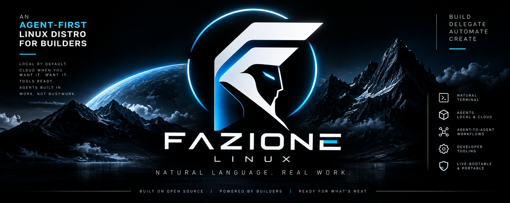
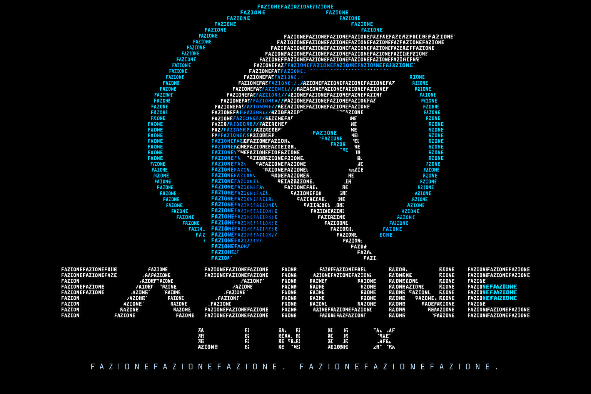
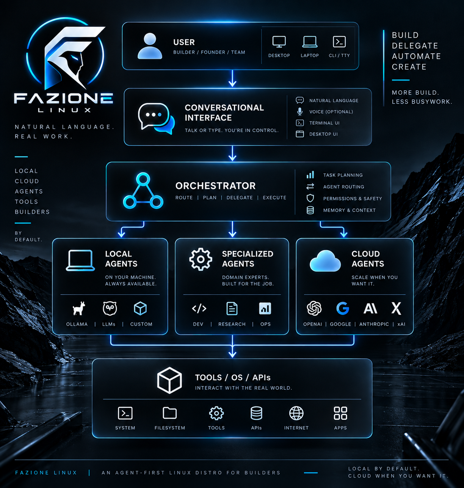

# Fazione
<p align="center">
    
</p>

> An agent-first Linux distribution for builders working with AI as part of the operating environment.

[](#)
[](#)
[](#)
[](#)

Fazione is an **agent-first Linux distribution** designed for builders who work with AI as part of the operating environment, rather than as an application layered on top.

Built on Ubuntu, Fazione centers the operating experience around **conversational control, local and cloud agents, agent-to-agent orchestration, and a preconfigured toolkit** for developing, running, and coordinating agentic systems.

Instead of treating the terminal purely as a command surface, Fazione treats it as an **execution interface**: describe what you need done, delegate the work, and let specialized agents handle the underlying tools and workflows.

> Think of Fazione as the Kali-shaped distro for agentic builders: opinionated, portable, live-bootable, and ready to work from first launch, without the security-tooling or pentesting identity.

**Local-first by default. Cloud when you want it. Built for people who would rather direct systems than babysit them.**

---

<p align="center">
    
</p>

## Why Fazione?

Most AI development environments begin with a conventional operating system and add agents on top.

Fazione starts from a different assumption:

**What should a Linux environment look like when agents are expected to operate it?**

That means designing around delegation rather than individual commands, orchestration rather than isolated prompts, and agent-accessible tooling rather than manually assembled development environments.

Fazione aims to provide a consistent environment where developers can:

- Direct system tasks conversationally.
- Run agents locally or through cloud providers.
- Delegate work between specialized agents.
- Build and test agentic applications.
- Give agents controlled access to system tools.
- Move between machines with a portable, live-bootable environment.
- Start with a useful agent development stack already configured.

---

## Core Principles

### Agent-First

Agents are treated as first-class participants in the operating environment, not as optional assistants attached to individual applications.

### Local-First

Run models, tools, workflows, and agents locally whenever practical. External providers remain available when additional capability or compute is needed.

### Conversational Control

Describe an outcome instead of translating every task into a sequence of shell commands.

```text
You
  |
  v
Intent
  |
  v
Agent / Orchestrator
  |
  +----> System Tools
  +----> Local Models
  +----> Cloud Models
  +----> Specialized Agents
  |
  v
Result
```

### Composable

Agents, models, tools, and providers should be replaceable components rather than permanent dependencies.

### Portable

Fazione is intended to support installation as well as live environments that can be carried between compatible systems.

### Opinionated

The distro ships with deliberate defaults for agentic development instead of requiring every user to assemble the same stack from scratch.

---

## Agent Environment

Fazione is designed around multiple types of agents working independently or together.

| Agent Type | Role | Example |
| --- | --- | --- |
| System Agent | Operates and configures the local environment | Packages, services, files, processes |
| Coding Agent | Develops and modifies software | Repositories, tests, builds |
| Research Agent | Collects and organizes information | Documentation, web research, analysis |
| Browser Agent | Interacts with browser-based workflows | Web applications and automation |
| Orchestrator | Delegates tasks between agents | Multi-agent workflows |
| Local Model Agent | Runs without requiring a cloud provider | Private or offline workflows |
| Cloud Agent | Uses remote models and services | High-capability or compute-heavy tasks |

> The final bundled agent set and supported providers are still being defined.

---

## Architecture

<p align="center">
    
</p>

A typical Fazione workflow is intended to follow this model:

```text
                    +------------------+
                    |       User       |
                    +--------+---------+
                             |
                             v
                    +------------------+
                    | Conversational   |
                    |    Interface     |
                    +--------+---------+
                             |
                             v
                    +------------------+
                    |   Orchestrator   |
                    +--------+---------+
                             |
             +---------------+---------------+
             |               |               |
             v               v               v
      +------------+   +------------+   +------------+
      |   Local    |   | Specialized|   |   Cloud    |
      |   Agents   |   |   Agents   |   |   Agents   |
      +------+-----+   +------+-----+   +------+-----+
             |                |                |
             +----------------+----------------+
                              |
                              v
                    +------------------+
                    | Tools / OS / APIs |
                    +------------------+
```

---

## Features

> Fazione is under active development. The list below describes the intended direction of the distribution and should not be interpreted as a guarantee of current availability.

- Ubuntu-based Linux environment
- Agent-first system design
- Conversational system control
- Local model support
- Cloud model integration
- Agent-to-agent orchestration
- Preconfigured agent development tooling
- Tool and workflow execution
- Live-bootable environment
- Portable development workspace
- Local-first operation
- Extensible agent and provider architecture

---

## Use Cases

### Agentic Development

Build, test, debug, and run agent-based software from an environment designed specifically for that workflow.

### Multi-Agent Workflows

Coordinate specialized agents for tasks that span development, research, system operations, browsing, and other tools.

### AI-Assisted System Operations

Delegate routine operating-system work while retaining access to the underlying Linux environment.

### Portable AI Workstation

Boot into a familiar agent development environment without rebuilding the entire toolchain on every machine.

### Local AI

Develop workflows that prioritize local inference, local tools, and local data while retaining the option to use external providers.

---

## Getting Started

> Installation images and release instructions will be added when public builds are available.

### Requirements

- 64-bit compatible system
- USB drive for live boot or installation
- [Minimum RAM TBD]
- [Recommended storage TBD]
- Internet connection for cloud-backed functionality

### Installation

```bash
# Installation instructions coming soon.
```

For development builds, see [`docs/development.md`](docs/development.md).

---

## Project Structure

```text
fazione/
├── build/              # Distribution build configuration
├── config/             # Default system and agent configuration
├── docs/               # Documentation and project assets
│   └── images/
├── packages/           # Fazione-specific packages
├── scripts/            # Build and installation tooling
├── agents/             # Agent definitions and integrations
└── README.md
```

> This structure is a placeholder and should be updated to match the repository.

---

## Security

Giving agents access to operating-system capabilities introduces a different security model from conventional desktop AI applications.

Fazione intends to make agent permissions, tool access, execution boundaries, and user approval explicit parts of the platform architecture.

The security and permission model will be documented before stable releases.

For security-related reports, see [`SECURITY.md`](SECURITY.md).

---

## Contributing

Fazione is in early development.

Contribution guidelines, development setup instructions, architectural documentation, and issue templates will be published as the project matures.

See [`CONTRIBUTING.md`](CONTRIBUTING.md) for project contribution guidelines.

---

## Documentation

Project documentation will live under [`docs/`](docs/).

Planned documentation includes:

- Installation
- Live boot
- Architecture
- Agent development
- Agent orchestration
- Local models
- Cloud providers
- Tool permissions
- System configuration
- Development and build process

---

## Project Status

**Early development**

Interfaces, bundled software, architecture, supported models, and other implementation details may change substantially before the first stable release.

---

## License

[License information TBD.]

---

## Fazione

**Direct the system. Delegate the work.**